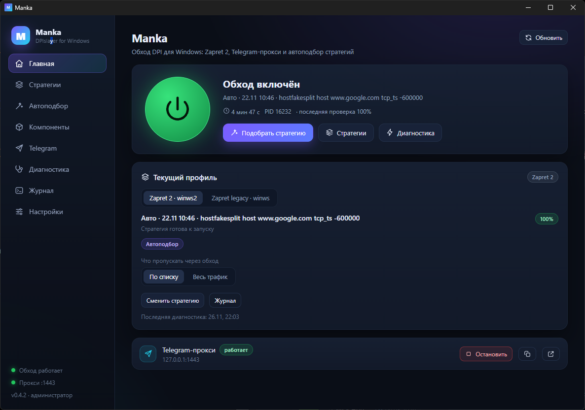
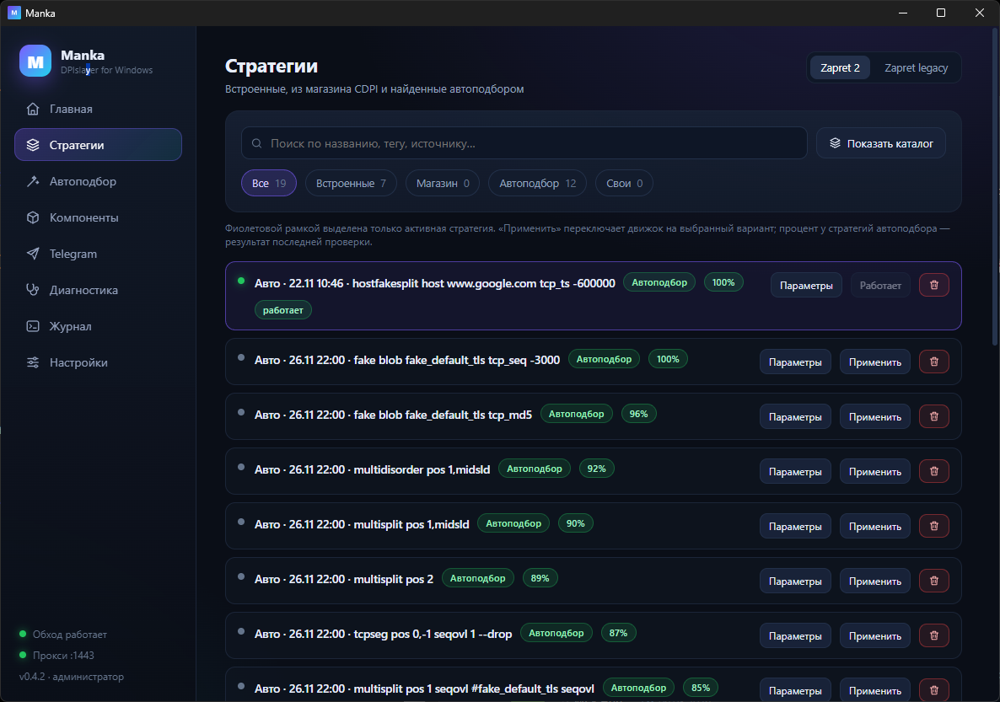
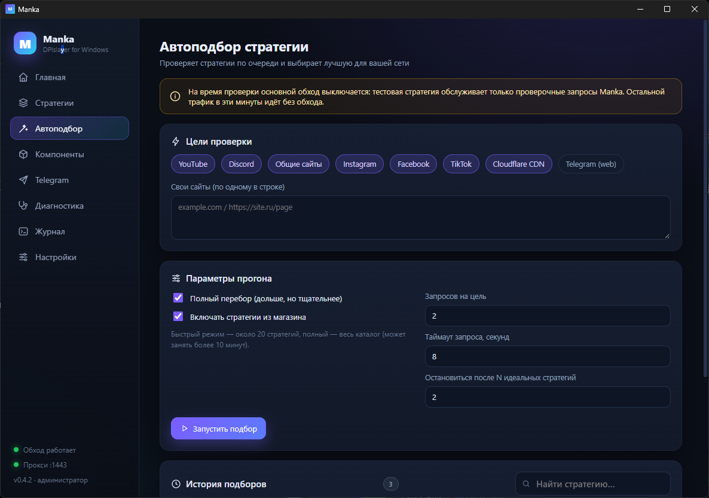
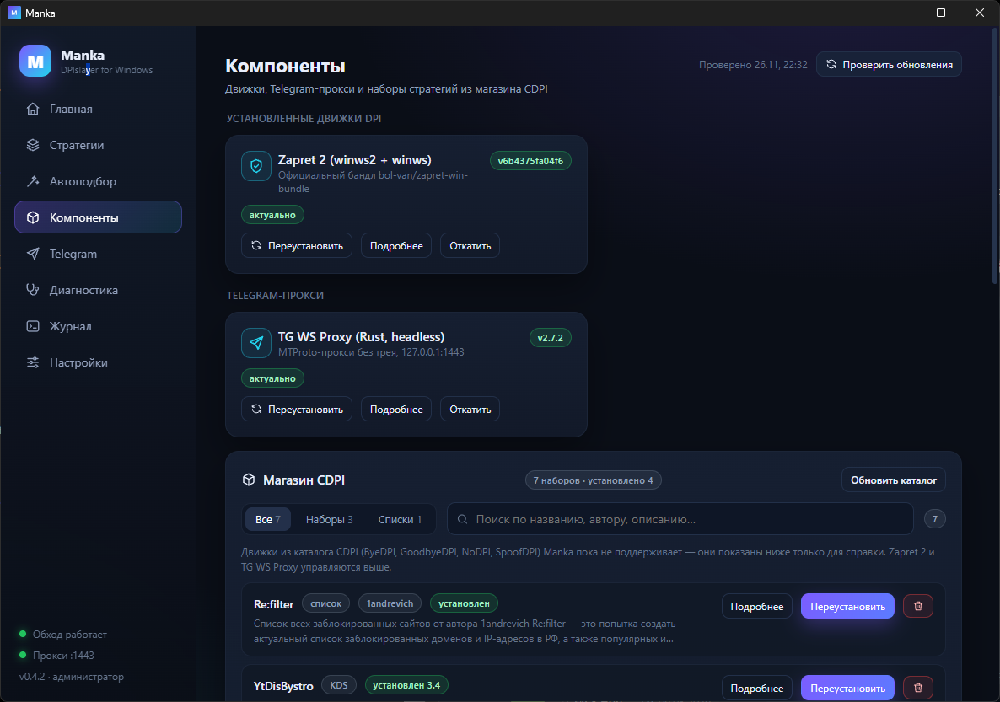
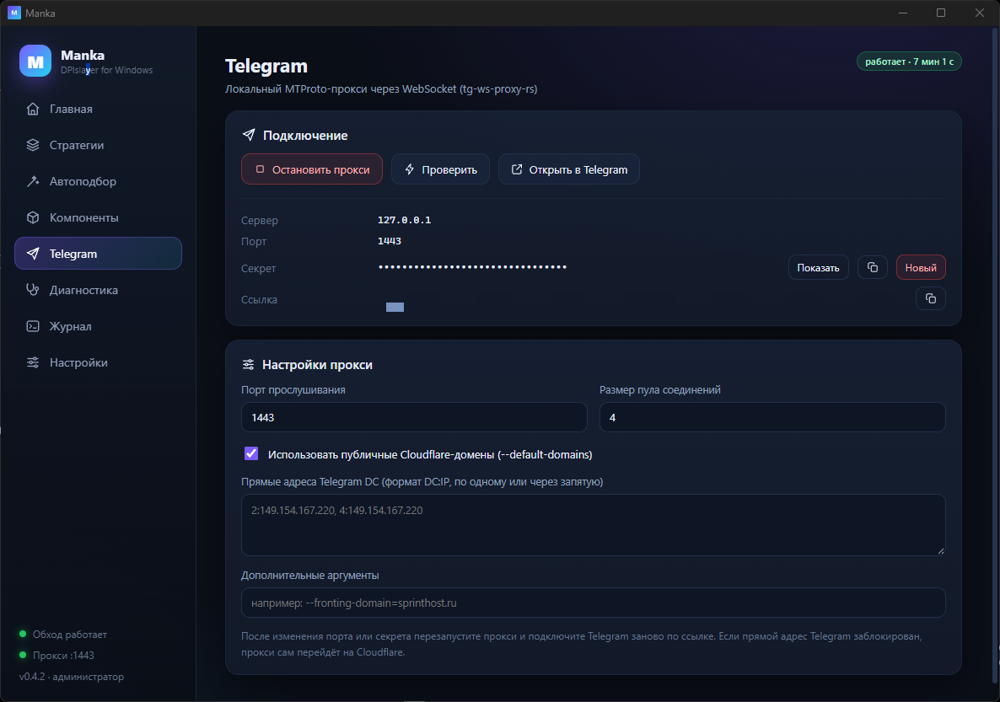
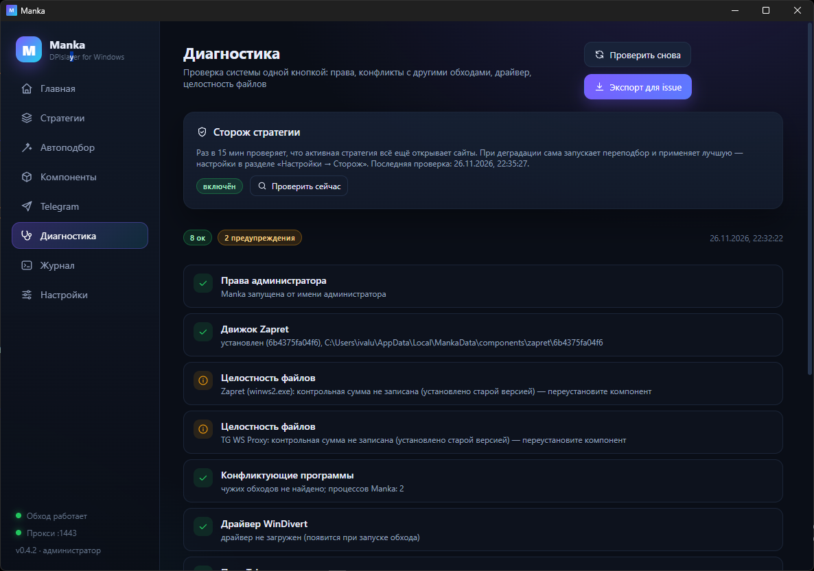
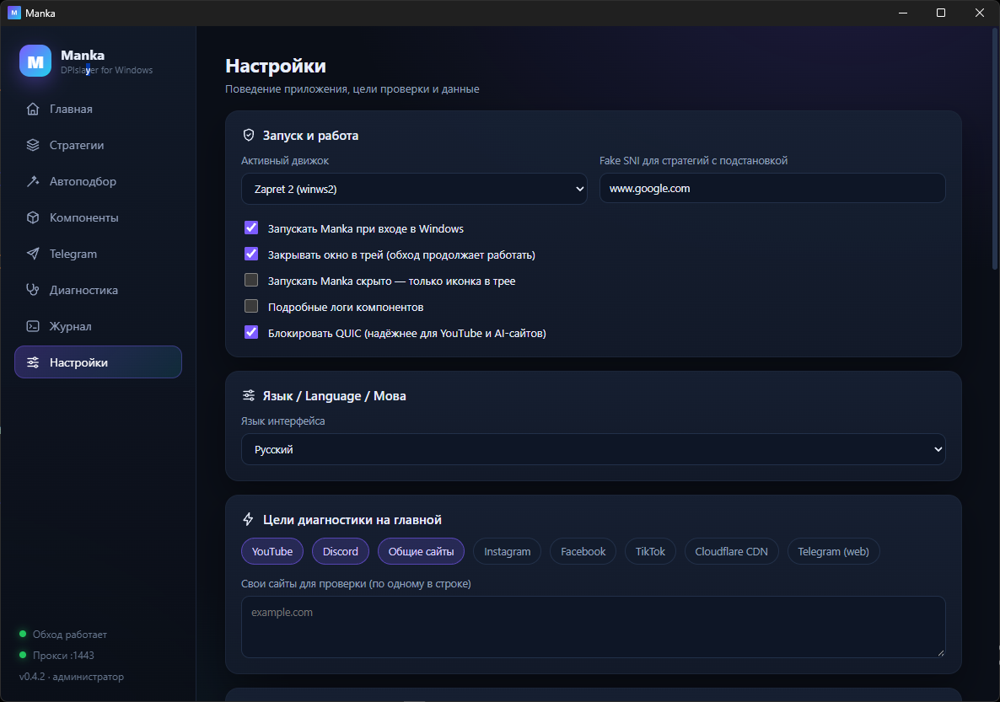

<p align="center">
  
</p>

<h1 align="center">Manka для Windows</h1>

<p align="center">
  <b>Обход DPI, Telegram-прокси и автоподбор стратегий — в одном окне.</b><br>
  Zapret 2 · Zapret legacy · TG WS Proxy · WinDivert
</p>

<p align="center">
  <a href="https://github.com/ivalushin0/Manka-UI/releases/latest">
    
  </a>
  <a href="README_EN.md">
    
  </a>
</p>

<p align="center">
  <a href="https://github.com/ivalushin0/Manka-UI/releases"></a>
  <a href="https://github.com/ivalushin0/Manka-UI/actions/workflows/ci.yml"></a>
  <a href="https://github.com/ivalushin0/Manka-UI/releases"></a>
  <a href="https://github.com/ivalushin0/Manka-UI/stargazers"></a>
  <a href="LICENSE"></a>
</p>

<p align="center">
  
</p>

> **Скачивайте только с GitHub.** У проекта нет других сайтов, зеркал на файлообменниках и
> «репаков». Если Manka предлагают скачать в другом месте — это не мы.

Manka — десктопная версия [Manka для Android](https://github.com/ivalushin0/manka).
Приложение ничего не подменяет в сети само: оно управляет официальными движками
(`winws2.exe`, `winws.exe`) и прокси `tg-ws-proxy-rs`.

## Что умеет

| | |
|---|---|
| 🚀 **Обход DPI** | Запуск `winws2`/`winws` от администратора, статус, uptime, логи. |
| 🧭 **Сторож стратегии** | Раз в 15 минут проверяет, что обход ещё открывает сайты. При деградации сам запускает переподбор и применяет лучшую стратегию. |
| 🩺 **Диагностика** | Одна кнопка: права, конфликты с GoodbyeDPI и другими обходами, драйвер WinDivert, целостность файлов, порты, автозапуск. Экспорт архива для issue — секреты вырезаются. |
| 🧩 **Компоненты как плагины** | Официальный [zapret-win-bundle](https://github.com/bol-van/zapret-win-bundle) и [tg-ws-proxy-rs](https://github.com/valnesfjord/tg-ws-proxy-rs) ставятся из первоисточников, с проверкой SHA256 и откатом. |
| 🎯 **Автоподбор** | Проверка TLS, HTTP и 64 КБ тела по целям (YouTube, Discord, Telegram, Instagram, TikTok, Cloudflare, свои сайты). Ранжирование по успеху и задержке, сохранение лучшей стратегии. |
| 🧱 **Режимы обхода** | «По списку» — только заблокированные домены; банки, игры и Госуслуги идут напрямую. «Весь трафик» — для редких сайтов. |
| 📚 **Списки доменов** | Встроенный список + автообновление внешних списков с зеркалами. `manka-exclude.txt` защищает банки, AI-сервисы и удалённый доступ от лишней подмены TLS. |
| ✈️ **Telegram-прокси** | Локальный MTProto-прокси на `127.0.0.1:1443`, ссылка `tg://`, проверка Cloudflare-маршрутов. Работает отдельно от обхода. |
| 🗂 **Трей и автозапуск** | Закрытие в трей, серая иконка при неработающем обходе, меню управления. Задача планировщика запускает Manka при входе без UAC. |
| 🌍 **Три языка** | Русский, English, українська. |

## Скриншоты

| Стратегии | Автоподбор |
|:---:|:---:|
|  |  |

| Компоненты | Telegram-прокси |
|:---:|:---:|
|  |  |

| Диагностика | Настройки |
|:---:|:---:|
|  |  |

## Быстрый старт

1. **Скачайте** установщик со [страницы релизов](https://github.com/ivalushin0/Manka-UI/releases/latest).
2. **Установите** и запустите Manka. На запрос UAC ответьте «Да» — без этого WinDivert не загрузится.
3. Нажмите **кнопку питания** на главном экране. Если стратегия не подходит вашей сети —
   откройте **Автоподбор** и нажмите «Запустить подбор».

Установщик ставит приложение в `%LOCALAPPDATA%\Manka`, а данные — отдельно,
в `%LOCALAPPDATA%\MankaData`. Удаление приложения не трогает профили, наборы и компоненты.

## Как это работает

```text
  браузер / приложения
          │
          ▼
   WinDivert (драйвер)  ◄── правила Zapret 2 / Zapret
          │
          ▼
   провайдер без DPI-блокировок
```

Один DPI-движок активен одновременно. Telegram-прокси работает отдельно и может быть
включён вместе с обходом. Списки доменов определяют, к каким сайтам применять десинхронизацию,
а `manka-exclude.txt` — к каким не применять никогда.

<details>
<summary><b>Безопасность</b></summary>

- **Проверка загрузок.** TG WS Proxy и наборы стратегий проверяются по SHA256-дайджесту,
  который GitHub публикует для каждого ассета; несовпадение = установка отменяется.
  Бандл Zapret скачивается по иммутабельному URL конкретного коммита.
- **Контроль целостности.** Хэш установленных `winws2.exe`/`tg-ws-proxy.exe` записывается
  при установке; «Доктор» сверяет его повторно и заметит подмену файлов.
- **CSP и валидация IPC.** В WebView включён строгий Content-Security-Policy, все команды
  бэкенда валидируют вход.
- **Подписанные обновления.** minisign через `tauri-plugin-updater`; приватный ключ не покидает
  машину разработчика и GitHub Secrets.
- **Атомарная запись настроек** (`MoveFileEx` с `WRITE_THROUGH`): сбой питания не оставит
  обрезанный `settings.json`.

### Антивирус ругается — это нормально?

WinDivert и `winws.exe` исторически детектируются некоторыми антивирусами как
«HackTool/Riskware» — так же реагируют на GoodbyeDPI, zapret и их GUI. Manka скачивает эти
файлы только из официальных репозиториев и проверяет контрольные суммы. Если сомневаетесь —
соберите Manka из исходников и сравните хэши.

</details>

<details>
<summary><b>Где лежат данные</b></summary>

`%LOCALAPPDATA%\MankaData`:

```text
settings.json        настройки
presets.json         свои и авто-стратегии
components\          zapret\<version>, tgws\<tag>, current.json
kits\<store_id>\     распакованные наборы CDPI
lists\               hostlist/ipset (включая manka-exclude.txt)
logs\                app.log, engine.log, tgws.log
results\history.json история автоподборов
store-index\         снимок CDPIUI-Store
```

`%LOCALAPPDATA%\Manka` — каталог установки, не данные. Для переноса на другой ПК достаточно
скопировать папку `MankaData` целиком; путь можно переопределить переменной `MANKA_DATA_DIR`.

</details>

<details>
<summary><b>Сборка из исходников</b></summary>

Требуется: Windows 10/11 x64, Rust (MSVC), Node.js 20+, WebView2, Visual Studio Build Tools + Windows SDK.

```powershell
npm install
cd app; npm install; cd ..

# установить компоненты и активировать встроенную стратегию
cargo run -p manka-core --example setup

# запуск приложения
.\node_modules\.bin\tauri.cmd dev
```

Если папка проекта синхронизируется облаком (OneDrive, pCloud и т.п.), задайте каталог сборки вне синхронизации:

```powershell
$env:CARGO_TARGET_DIR="$env:LOCALAPPDATA\Temp\manka-target"
```

Сборка установщика:

```powershell
.\node_modules\.bin\tauri.cmd build
# target\release\bundle\nsis\Manka_<version>_x64-setup.exe
# target\release\bundle\nsis\latest.json (манифест обновлений)
```

</details>

<details>
<summary><b>Обновления через GitHub</b></summary>

Manka проверяет и устанавливает обновления из GitHub Releases (`tauri-plugin-updater`).

1. В приложении: **Настройки → Обновления Manka** → репозиторий уже заполнен как
   `ivalushin0/Manka-UI`; при форке укажите свой в формате `owner/repo`.
2. В настройках репозитория на GitHub добавьте секреты Actions:
   - `TAURI_SIGNING_PRIVATE_KEY` — содержимое файла `%USERPROFILE%\.manka\updater.key`;
   - `TAURI_SIGNING_PRIVATE_KEY_PASSWORD` — пусто, если ключ без пароля.
3. Поднимите версию в `src-tauri/Cargo.toml`, `src-tauri/tauri.conf.json`, `app/package.json`,
   `package.json` и создайте тег:
   ```powershell
   git tag v0.4.2
   git push origin v0.4.2
   ```
4. Workflow соберёт NSIS-установщик, подпишет его и создаст черновик релиза с `latest.json`.
   Публичный ключ уже прописан в `src-tauri/tauri.conf.json`.
   Приватный ключ **не коммитьте**.

</details>

<details>
<summary><b>Структура репозитория</b></summary>

```text
app/                     Svelte 5 + Vite UI (i18n: ru/en/uk)
src-tauri/               Tauri v2 shell: команды, трей, автозапуск, сторож
crates/manka-core/       модели, провайдеры компонентов, каталог стратегий, runner,
                         пробы, автоподбор, диагностика, списки, сторож
crates/manka-core/tests  smoke-тест с реальными загрузками
crates/manka-core/examples setup, autoselect_smoke
docs/                    архитектура, форматы данных, списки
```

</details>

<details>
<summary><b>CI/CD и ограничения</b></summary>

- **CI**: на каждый push/PR — `cargo fmt --check`, `clippy -D warnings`, тесты ядра,
  `svelte-check`, сборка фронтенда; еженедельно — `cargo audit` / `npm audit`.
- **Release**: по тегу `v*` собирает NSIS-установщик, подписывает артефакты и создаёт
  черновик релиза с `latest.json`.

Ограничения текущей версии:

- Нет службы `SYSTEM`: движок запускается из процесса приложения (нужен один UAC при старте,
  если приложение не запущено планировщиком).
- Windows-порт не управляет DNS/hosts, исключениями приложений и «прокси для приложений» (Xray).
- Кроссплатформенность не проверялась: код Windows-first.

</details>

## Документация

| Документ | О чём |
|---|---|
| [docs/DESKTOP.md](docs/DESKTOP.md) | устройство десктопного приложения |
| [docs/DATA.md](docs/DATA.md) | форматы данных и файлов |
| [docs/LISTS.md](docs/LISTS.md) | как работают списки обхода и исключений |
| [docs/ARCHITECTURE-PROPOSAL.md](docs/ARCHITECTURE-PROPOSAL.md) | исходный дизайн-док |

## Лицензии

Код Manka — MIT. Компоненты распространяются отдельно: zapret/zapret2 (MIT),
tg-ws-proxy-rs (MIT), CDPIUI-Store и наборы — по лицензиям их авторов.
