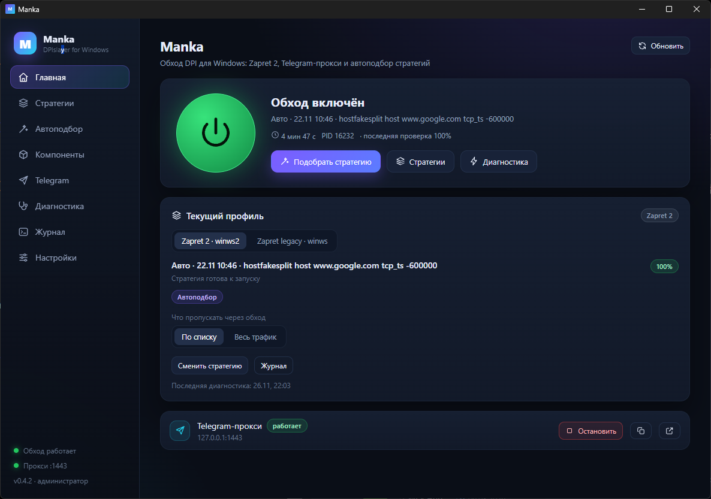
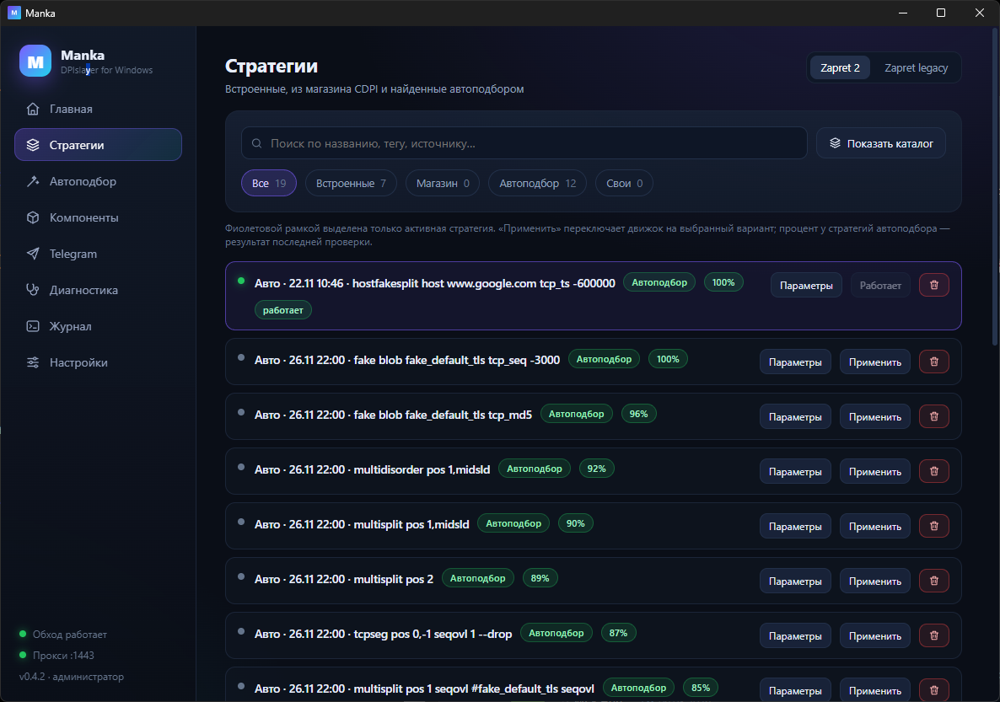
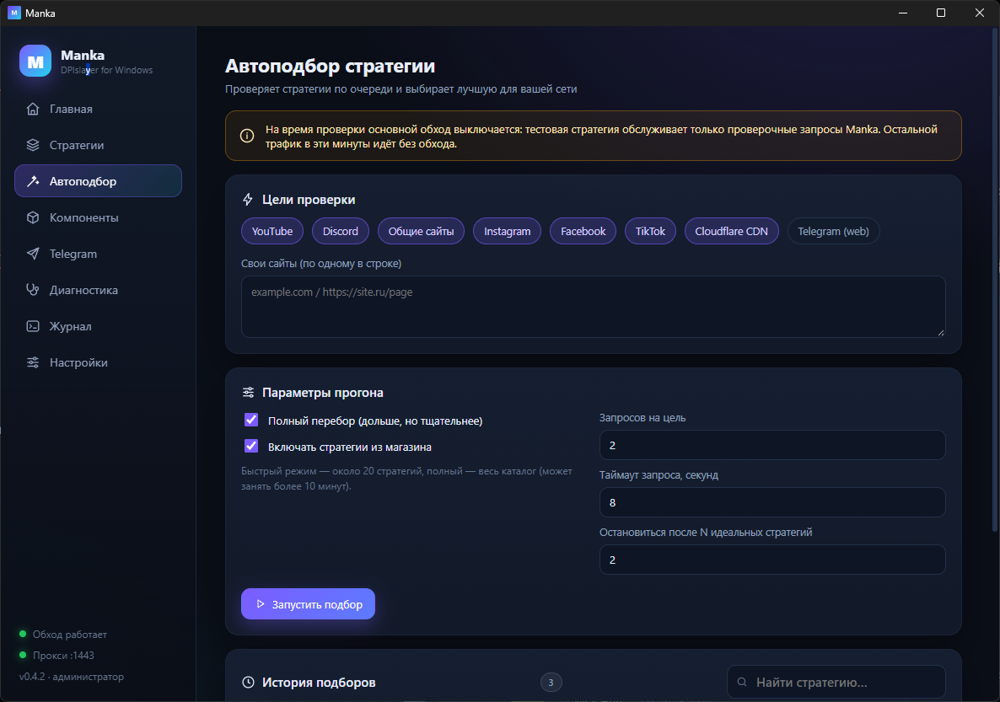
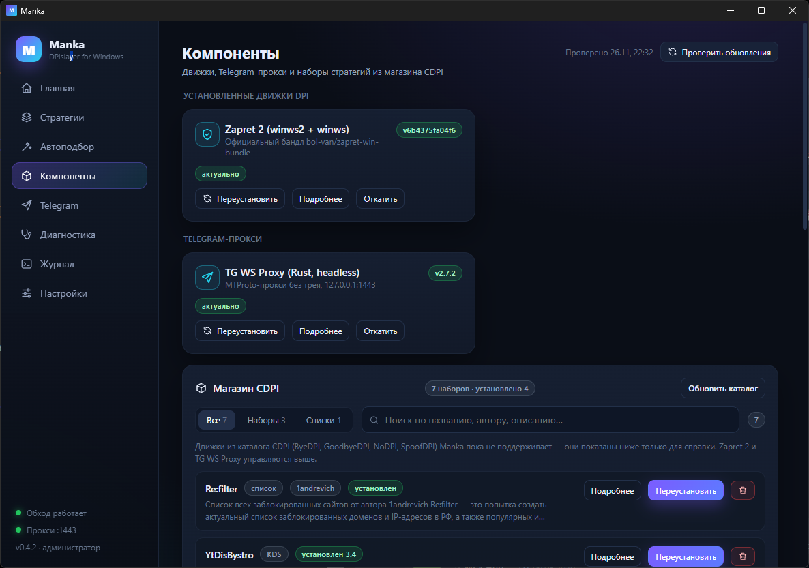
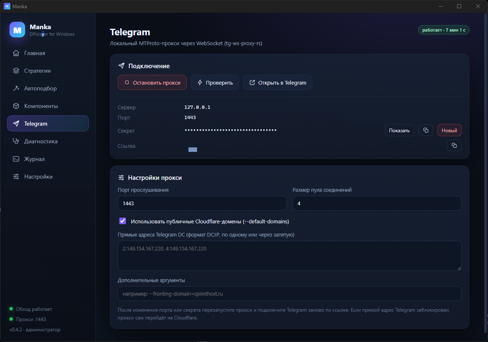
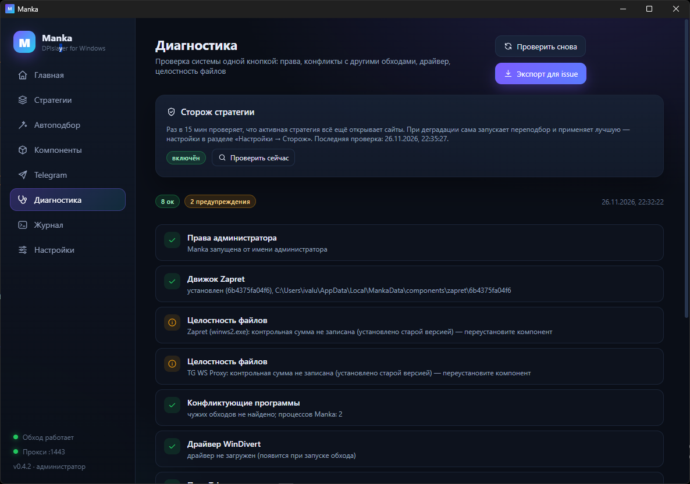
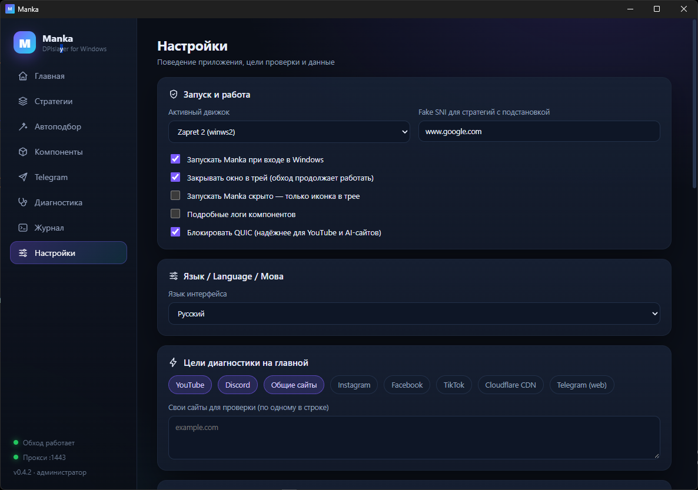

<p align="center">
  
</p>

<h1 align="center">Manka for Windows</h1>

<p align="center">
  <b>DPI bypass, Telegram proxy and strategy auto-selection in one window.</b><br>
  Zapret 2 · Zapret legacy · TG WS Proxy · WinDivert
</p>

<p align="center">
  <a href="https://github.com/ivalushin0/Manka-UI/releases/latest">
    
  </a>
  <a href="README.md">
    
  </a>
</p>

<p align="center">
  <a href="https://github.com/ivalushin0/Manka-UI/releases"></a>
  <a href="https://github.com/ivalushin0/Manka-UI/actions/workflows/ci.yml"></a>
  <a href="https://github.com/ivalushin0/Manka-UI/releases"></a>
  <a href="https://github.com/ivalushin0/Manka-UI/stargazers"></a>
  <a href="LICENSE"></a>
</p>

<p align="center">
  
</p>

> **Download only from GitHub.** There are no mirrors, file-sharing copies or "repacks".
> If Manka is offered anywhere else, it is not us.

Manka is the desktop sibling of [Manka for Android](https://github.com/ivalushin0/manka).
The app implements no network trickery itself: it orchestrates the official engines
(`winws2.exe`, `winws.exe`) and the `tg-ws-proxy-rs` proxy.

## Features

| | |
|---|---|
| 🚀 **DPI bypass** | Runs `winws2`/`winws` as administrator with status, uptime and logs. |
| 🧭 **Strategy watchdog** | Health-checks the active strategy every 15 minutes. When your ISP tightens DPI, it re-runs auto-selection and applies the best result automatically. |
| 🩺 **Diagnostics** | One click: privileges, conflicts with GoodbyeDPI and other tools, the WinDivert driver, binary integrity, busy ports, autostart. Exports a redacted archive for issues. |
| 🧩 **Components as plugins** | The official [zapret-win-bundle](https://github.com/bol-van/zapret-win-bundle) and [tg-ws-proxy-rs](https://github.com/valnesfjord/tg-ws-proxy-rs) are installed from source with **SHA256 verification** and rollback. |
| 🎯 **Auto-selection** | TLS, HTTP and 64-KB-body probes against YouTube, Discord, Telegram, Instagram, TikTok, Cloudflare and custom sites. Ranked by success rate and latency. |
| 🧱 **Bypass scopes** | "List only" keeps banks, games and government sites direct; "all traffic" helps with rare sites. |
| 📚 **Domain lists** | Built-in list + scheduled updates of external lists with mirrors. `manka-exclude.txt` keeps banks, AI services and remote-access tools untouched. |
| ✈️ **Telegram proxy** | Local MTProto proxy on `127.0.0.1:1443`, `tg://` link, Cloudflare route check. Independent of the bypass. |
| 🗂 **Tray and autostart** | Close to tray, grey icon when the bypass is down, Task Scheduler autostart without a UAC prompt. |
| 🌍 **Three UI languages** | Русский, English, українська. |

## Screenshots

| Strategies | Auto-selection |
|:---:|:---:|
|  |  |

| Components | Telegram proxy |
|:---:|:---:|
|  |  |

| Diagnostics | Settings |
|:---:|:---:|
|  |  |

## Quick start

1. **Download** the installer from the [releases page](https://github.com/ivalushin0/Manka-UI/releases/latest).
2. **Install** and launch Manka. Accept the UAC prompt — WinDivert cannot load otherwise.
3. Press the **power button** on the home screen. If the strategy does not fit your network,
   open **Auto-selection** and press "Start".

The installer puts the app in `%LOCALAPPDATA%\Manka` and keeps data separately in
`%LOCALAPPDATA%\MankaData`. Uninstalling the app does not touch profiles, kits or components.

## How it works

```text
  browser / apps
          │
          ▼
   WinDivert (driver)  ◄── Zapret 2 / Zapret rules
          │
          ▼
   ISP without DPI blocks
```

Only one DPI engine is active at a time. The Telegram proxy runs separately and can be enabled
together with the bypass. Domain lists decide which sites get desynchronisation, and
`manka-exclude.txt` decides which sites are never touched.

<details>
<summary><b>Security</b></summary>

- TG WS Proxy and strategy kits are verified against the **SHA256 digests GitHub publishes**
  for every release asset; a mismatch aborts the install and deletes the file.
- The Zapret bundle is downloaded by an **immutable commit URL**, never a moving branch.
- The Doctor re-hashes installed executables to detect post-install tampering.
- Strict Content-Security-Policy in the WebView; all IPC commands validate their input.
- App updates are minisign-signed (`tauri-plugin-updater`).
- Settings are written atomically (`MoveFileEx` + `WRITE_THROUGH`); a corrupt file is backed up.

**Antivirus flags?** WinDivert and `winws.exe` are historically flagged as "HackTool/Riskware"
by some vendors — GoodbyeDPI and zapret GUIs get the same. Manka downloads them only from the
official repositories and verifies checksums; you can also build from source and compare.

</details>

<details>
<summary><b>Data location</b></summary>

`%LOCALAPPDATA%\MankaData` (override with `MANKA_DATA_DIR`): settings, presets, components,
kits, lists, logs, auto-selection history, store snapshot. Copy the whole folder to move to
another PC. See [docs/DATA.md](docs/DATA.md) for file formats.

</details>

<details>
<summary><b>Build from source</b></summary>

Requires: Windows 10/11 x64, Rust (MSVC), Node.js 20+, WebView2, Visual Studio Build Tools + Windows SDK.

```powershell
npm install
cd app; npm install; cd ..

# install components and activate a built-in strategy
cargo run -p manka-core --example setup

# run the app
.\node_modules\.bin\tauri.cmd dev
```

Build the installer:

```powershell
$env:CARGO_TARGET_DIR="$env:LOCALAPPDATA\Temp\manka-target"   # if the repo lives in cloud sync
.\node_modules\.bin\tauri.cmd build
# target\release\bundle\nsis\Manka_<version>_x64-setup.exe
```

</details>

<details>
<summary><b>Limitations</b></summary>

- No SYSTEM service yet: engines are children of the app process (one UAC prompt at start
  unless launched via Task Scheduler autostart).
- The Windows port does not manage DNS/hosts, per-app routing or Xray — planned after the service.
- Code is Windows-first; cross-platform builds are untested.

</details>

## Documentation

| Document | Contents |
|---|---|
| [docs/DESKTOP.md](docs/DESKTOP.md) | desktop app architecture |
| [docs/DATA.md](docs/DATA.md) | data and file formats |
| [docs/LISTS.md](docs/LISTS.md) | bypass and exclusion lists |
| [docs/ARCHITECTURE-PROPOSAL.md](docs/ARCHITECTURE-PROPOSAL.md) | original design doc |

## License

Manka code — MIT. Components are distributed separately: zapret/zapret2 (MIT),
tg-ws-proxy-rs (MIT), CDPIUI-Store and kits — under their authors' licenses.
